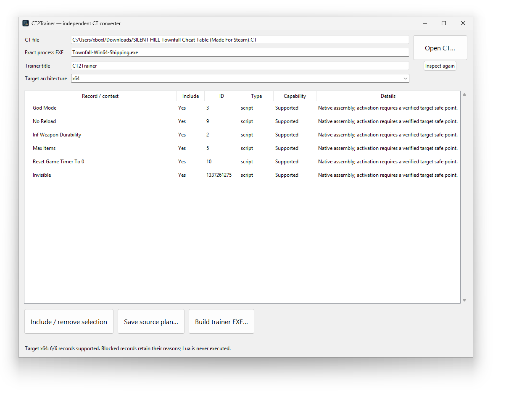
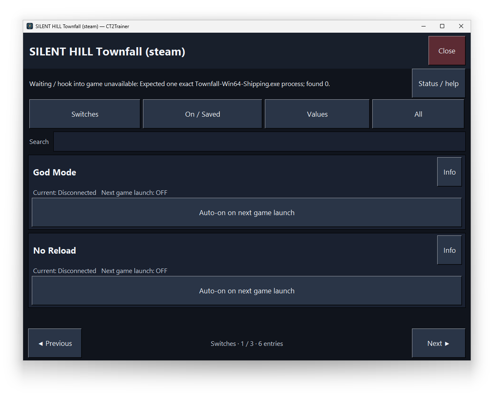

# CT2Trainer

CT2Trainer is an independently authored converter and Windows trainer for
`.CT` (Cheat Engine XML) table files. It reads a table and the exact game
process EXE name, then produces a standalone trainer EXE that attaches to
the running game and toggles the table's features on and off — **without
ever installing or running Cheat Engine**.

The implementation is a clean-room project: it uses no external trainer
source code, binaries or data — only the public `.CT`/XML format contract
and documented behavior are derived.

## Provenance

This repository — code, tests, tooling, documentation and release
artifacts — is fully AI-generated: developed end-to-end by AI agents
under human direction. AI-authored commits are welcome; the working
contract for agents (boundaries, build rules, lane protocol) is
documented in `AGENTS.md` and
`plans/native-implementation-continuation.md`.

## Why it exists

`.CT` tables are authored in Cheat Engine, but a table is useful
independently of the tool that wrote it. You may want to keep using tables
you already have on a machine where Cheat Engine is not installed or not
wanted (for example a clean test machine, or a Steam Deck under Proton
where a full debug suite is impractical), or simply prefer a small
dedicated trainer over the full environment. CT2Trainer closes that gap:

- it **reuses your existing tables** instead of rebuilding every feature
  by hand;
- the result is a **standalone trainer EXE** — no Cheat Engine, no Python
  installation on the game machine, no background tooling;
- the whole chain (converter, generated trainer, source build) is
  **CE-free**: the build takes no CE inputs, and the release archives ship
  no CE binaries.

The scope is **private own use**: convert your own tables for the game
processes you own and play.

## What it can do

### The converter (`CT2Trainer-Converter.exe`)

- opens any `.CT` table (XML) and inspects it **statically**: the
  converter never executes the table's Lua or Auto Assembler code;
- lists every record with its capability state — **supported**,
  **staged**, or **blocked** — with a named reason for every record that
  is not fully supported, so you know exactly what the trainer will and
  will not do before you build;
- takes the **exact target process EXE name** (basename) plus the
  architecture, lets you select the records to include, and builds the
  standalone trainer EXE;
- shows the build version and a repository link in the window title.

### The generated trainer

- attaches to the running target process and **re-proves the target
  identity** (PID/creation time, PE header, architecture, ownership,
  current bytes) before any memory mutation;
- shows one switch card per record with its current state, per-record
  toggles, group navigation and a master toggle;
- supported record types:
  - **value records**: 4/8/16/32/64-bit integers (decimal and hex),
    float/double — including raw IEEE-754 bit-pattern editing, string
    values, and dropdowns, including value-linked dropdowns whose
    choices are validated against the record's own type;
  - **Auto Assembler patches**: byte/code patches, AOB scans (including
    the `$process` module token), program-owned allocations and
    `dq`/`resb` reservations, one-shot scripts, and `alloc`-only
    initialization scripts that reserve memory without touching the game;
  - **activation structures**: parent/child groups with flag cascades,
    record-ID activation sets, and **staged records** — records whose
    address needs a symbol provided by another record show a pending
    state and unlock automatically once their provider is enabled
    (turning the provider OFF releases the children first);
- **saved toggles**: only confirmed ON-switches are persisted, and they
  are automatically re-enabled after a successful re-attach (game or
  trainer restart, on a freshly verified target); a failed enable attempt
  stays visibly inactive and is never re-applied as a saved wish;
- staged features are gated at runtime on provider liveness with a named
  fail-closed error while the provider is inactive.

## Screenshots

The converter inspects a `.CT` table, takes the exact target EXE name and
architecture, and lists every record with its include flag and capability:



The generated trainer shows one switch card per record with its current
state, auto-on for the next game launch and navigation; while the target
process is not running, the hooks stay in the waiting state:



## Inputs

Every conversion requires exactly two inputs:

1. a **`.CT` table file** (XML format), and
2. the **exact game process EXE name** (basename) the trainer must attach
   to.

Saved enabled toggles are automatically re-enabled after a successful
re-attach. Only confirmed ON-switches are persisted; a failed enable
attempt stays visibly inactive and is never re-applied as a saved wish.
See [documentation/usage.md](documentation/usage.md) for the full
contract.

## Quick start

### Portable ZIP

1. Unzip the archive and run `CT2Trainer-Converter.exe` — no Python,
   NASM or other installation is required.
2. Open your `.CT` table, enter the exact target EXE basename, and
   confirm the architecture (x64).
3. Review the per-record states (supported / staged / blocked with
   reasons) and select the records you want.
4. Build the trainer EXE, start the game, and run the generated trainer:
   it attaches to the verified process and exposes one toggle per
   selected record.
5. Enabling a switch persists it; the next attach (game restart or
   trainer restart) re-enables all saved switches automatically.

### Source build (Windows x64, fully offline)

```powershell
powershell.exe -NoProfile -ExecutionPolicy Bypass -File scripts\Build-Native.ps1
```

The build verifies the pinned offline inputs, runs the full test suite,
and produces both `CT2Trainer-<version>-source.zip` and
`CT2Trainer-<version>-windows-portable.zip` plus a build report
(`build.json`) in a fresh `build/runs/` folder. Requirements, the local
test suite, and the release content rules are documented in
[documentation/build.md](documentation/build.md).

### Source CLI (developers)

```bat
python -m ct2trainer.native inspect <table>.CT
python -m ct2trainer.native prepare <table>.CT --process <target>.exe --output build\fixture
python -m ct2trainer.native build <table>.CT --process <target>.exe --output build\out --architecture x64
```

`inspect` is static and read-only; `prepare` only produces a JSON plan —
a plan or its hash grants no target write permission; `build` produces
the trainer EXE. If a previous session left a stale state lock, the
source CLI offers explicit `assess-recovery` / `recover` steps (see
[documentation/usage.md](documentation/usage.md) §4).

## Fail-closed boundaries

- Records that cannot be supported are **not dropped silently**: they
  stay visible in the converter with a named block reason and are simply
  excluded from the generated trainer — no silent guessing.
- The generated trainer never writes to memory before the target
  identity is re-proven; a stale or mismatched process is refused.
- One-shot (irreversible) scripts get the honest one-shot contract — no
  faked OFF/save/re-apply.
- Final acceptance is separate on Windows and on a real Steam Deck under
  Proton with touch operation; until both pass, the build carries
  `runtime_unverified: true`.

## Repository layout

| Path | Purpose |
| --- | --- |
| `src/ct2trainer/native/` | independent converter/trainer implementation |
| `src/ct2trainer/` | shared base modules (table parsing, capabilities, process detection) |
| `tools/` | build helper (`native_build.py`), corpus denominator tooling, icon generator |
| `scripts/Build-Native.ps1` | the single build entry point |
| `tests/` | native test suite, Windows fixture targets, Proton/Steam Deck protocol |
| `TableReferences/` | synthetic clean-room corpus (27 pinned case tables) |
| `gap_inventory/` | committed measurement artifacts (run `repo-reproducible`) |
| `dependencies/` | hash-pinned offline build inputs (Python, PyInstaller, NASM, iced-x86, Lupa, selected Mono API sources) |
| `licenses/` | CT2Trainer MIT grant and third-party notices |
| `documentation/` | build, usage, derivation, runtime, verification and agent-workflow docs |
| `AGENTS.md` | agent handoff: project boundaries, workflow and launch rules (local tooling, not shipped) |
| `plans/` | implementation and continuation plan: work packages, acceptance, open work |

## Verification status

- Full native suite: **3233 OK / 25 expected skips, 0 failures**.
- Feature matrix: **42/42 in-scope features covered** (100%
  feature-weighted, 7446/7446 action-weighted) over the pinned corpus of
  6,119 expected actions (27 pinned case tables, run
  `w4-case31-20261019061339`).
- Gates 1–3 (per-table completeness, Source-to-Frozen parity, reproducible
  chain) are closed with tested evidence.
- The AP-11 campaign (observed real-game effect for all 6,119 actions) is
  a separate open end goal and is excluded from the 100% feature metric.
- `runtime_unverified` stays set until real Windows and Steam Deck/Proton
  acceptance runs pass. See
  [documentation/native-verification.md](documentation/native-verification.md).

## License

The independently authored implementation is released under the MIT
License (see [LICENSE.md](LICENSE.md) and
`licenses/CT2Trainer-MIT.txt`). Third-party components ship under their
own licenses (MIT/BSD; CPython under the PSF license; PyInstaller is a
GPL-2.0-with-bootloader-exception build tool whose bootloader is
embedded in the generated EXEs). See
[licenses/Native-THIRD-PARTY.txt](licenses/Native-THIRD-PARTY.txt) for
the full notice list.

User-selected CT content is separate input with its author's rights;
building a trainer from a table does not license that table.
