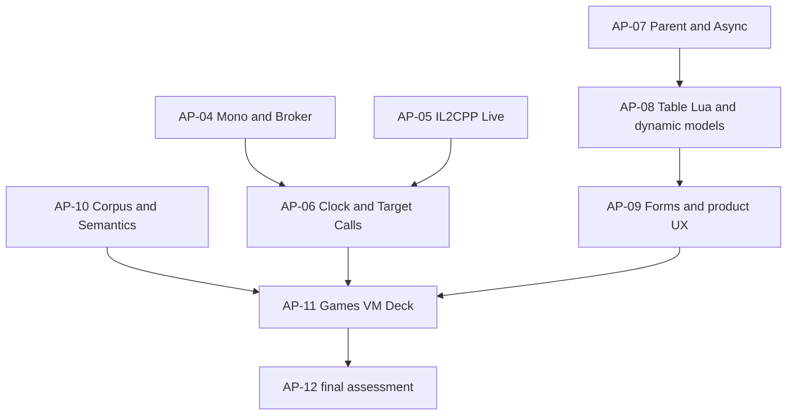

# CT2Trainer: Implementation and continuation plan

Status: **October 11, 2026** (0.10 in cycle on working branch
**`native-0.9-staged`**; `main` tracks the milestone between cycle-end
merges — see §7).

This plan is maintained with every integration, new check, and handoff.
The binding result list is in
[native-progress.md](../documentation/native-progress.md). The work
packages **AP-01 through AP-12** below carry scope and status; AP-01
through AP-10 are complete, **AP-11 and AP-12 remain open**.

## 1. Mandate and completion criteria

An independently developed CT2Trainer must import `.CT` files and
produce real standalone trainers from them. The implementation uses
neither CE implementation code nor CE binaries, resources, drivers, or
patched CE Lua libraries. The public `.CT`/XML format contract,
documented behavior, and the synthetic clean-room corpus
(`TableReferences/`) serve to derive and pin the contract. Original
table Lua and Auto Assembler code is not executed by the local tooling
(converter, tests, corpus analysis).

MIT/BSD components may be forked locally, adapted, and further developed
even with a broken upstream API. Every adoption keeps original sources,
commit/version, license, file hashes, a description of local changes, and
a reproducible build or an evidenced source adaptation. A full
mixed-license SDK/runtime folder is not treated as a redistributable
closure just because of individual MIT files.

Completion criteria:

- **Feature matrix: 100% in-scope coverage without AP-11 — reached and
  extended (2026-10-11, WP-14).** 42/42 in-scope features covered
  (39 gap classes + 3 gates): 100% feature-weighted, 7361/7361
  action-weighted over the pinned 6011-action corpus (14 tables, run
  `wp14-staged-20261011T093320Z`; `gap_inventory/feature-coverage.json`).
  The 90% hurdle and the original 100% goal (2026-10-10, 39/39 over
  5967) remain closed.
- **Gates 1–3 closed with real, tested evidence** (see §2). Gate action
  weights remain 0 — they are completeness/proof features, not record
  actions.
- **AP-11 (real-game confirmation of all 6011 pinned actions) remains a
  separate end goal** and is excluded from the feature metric
  (0 confirmed so far).
- **Product acceptance is still open** on both platforms: standalone
  operation on Windows (converter/trainer without CE or Python
  installation, confirmed switch effect and undo, values/freeze, saved
  successful wishes, PID/controller changes, comprehensible lock
  reasons) and on a real Steam Deck under Proton with touch operation.
  `runtime_unverified` stays set until both pass.

Irreversible one-time calls receive no faked OFF/save/reapply contract:
exactly one publish per attempt, save only after a confirmed ON, failed
attempts stay visibly inactive and are never replayed as saved wishes.

## 2. Current binding state

| Item | State (verified) |
| --- | --- |
| Repository baseline | `main` @ `b6c48cc` "initial 0.9 version" — the self-contained 0.9 tree (source, tests, synthetic corpus, docs) |
| Test suite | local dev suite 2710 OK / 25 expected skips, 0 failures on `main` after the WP-18 merge (`9a76eb8`, 2026-10-12); latest offline build suite 2710/25 (0.11 build `native-20261012T092729Z-2d8aaf12`) |
| Feature matrix | 42/42 in-scope features covered = 100% feature-weighted, 7361/7361 action-weighted; committed artifacts under `gap_inventory/` (run `wp14-staged-20261011T093320Z`) |
| gate:1 per-table completeness | closed — `tests/test_native_table_completeness.py`: all 14 pinned tables, every source record preserved, table-level constructs (Forms, Lua lifecycle, Custom Types, Assets) handled or surfaced fail-closed, synthetic embedded-Files case |
| gate:2 Source-to-Frozen parity | closed — `tests/test_native_source_frozen_parity.py` (corpus plans byte-identical through `build_trainer`/`read_embedded_plan`) plus the binary static-IL2CPP probe adapter `src/ct2trainer/native/il2cpp_static_probe.py` (frozen launcher `--il2cpp-static-pe/--il2cpp-static-metadata/--il2cpp-static-report`, source CLI `ct2trainer native il2cpp`, `tests/test_native_il2cpp_static_probe.py`) |
| gate:3 reproducible chain | closed — `tests/test_native_repro_chain.py`: denominator → feature matrix → AP-11 manifest byte-identical for a fixed run-id |
| AP-11 campaign | open — baseline manifest committed (`gap_inventory/ap11-campaign.json`: 14 tables, 6011 expected actions, 0 confirmed, `all_ok`, run `wp14-staged-20261011T093320Z`); runbook in [native-ap11-campaign.md](../documentation/native-ap11-campaign.md) |
| Latest verified build | `native-20261010T172336Z-ffe35eb0` via `scripts/Build-Native.ps1`: both ZIPs, in-build suite 2617/25, `ce_inputs: []`, `runtime_unverified` deliberately set |

The portable ZIP was user-tested in that state: the converter run and a
generated trainer EXE work without CE or Python installed on the
machine.

## 3. Resumption after interruption

1. Check the checkout state: `git status --short --branch`,
   `git log -5 --oneline`, `git remote -v`. Work on `main` or the current
   milestone working branch; preserve existing changes.
2. Read `AGENTS.md`, this plan, `documentation/native-progress.md`,
   `documentation/native-runtime.md`, `documentation/native-verification.md`,
   and `documentation/build.md`. Do not carry build commands from other
   projects over to Native.
3. Check the active goal status and still-alive subagents. Do not
   delegate completed packages twice. Messages/handoffs are context, not
   a new user clearance for game actions or external communication.
4. Distinguish the last commit from active uncommitted changes and
   published binary states. Reports under `build/runs/` are historical
   for their pinned bytes only; if inputs changed, re-run the checks.
5. Tooling: `scripts/Build-Native.ps1` is the only build entry point and
   is fully self-contained (fresh run folder with its own venv and
   restored NASM per build). For local test runs use the development
   venv and NASM, created offline from `dependencies/` (all paths
   relative to the repository root):

   ```powershell
   & .tools\python\python.exe -m venv .tools\native-build-env
   & .tools\native-build-env\Scripts\python.exe -m pip install --no-index --find-links dependencies\native\lupa --find-links dependencies\native\iced-x86 lupa==2.8 iced-x86==1.21.0
   & .tools\native-build-env\Scripts\python.exe tools/native_build.py restore-nasm --output .tools/native-tools
   ```

   (requirements: `documentation/build.md` §1). If the development venv
   is unavailable, every green build run folder under `build/runs/`
   carries its own `venv/Scripts/python.exe` and `native-tools/nasm.exe`.
6. Coordinate process names and active agents before an own-C probe.
   Only manage own newly started children. Neither terminate nor delete
   foreign or later-reused PIDs and unknown journals. An unclear effect
   keeps locks.
7. Reserve a new `build/runs/<UTC>-<random>-<package>` folder for fresh
   evidence. Store baseline hashes, environment, and the first intended
   action. Do not overwrite existing reports; failed attempts belong to
   the evidence.
8. Continue at the first open package with fulfilled dependencies.
   Assign independent packages in parallel; shared engine/compiler files
   may only be written by one integrator. After a new integration, run
   the full suite, then update this plan and the progress ledger.

### Known working tools and commands

From the repository root in PowerShell (all paths relative to the
root); for tests use the development venv, since bare Python may lack
Lupa/iced:

```powershell
$env:PYTHONPATH = (Resolve-Path src).Path + ";" + (Resolve-Path tests).Path
$env:PYTHONIOENCODING = "utf-8"
$env:CT2TRAINER_NASM = (Resolve-Path .tools/native-tools/nasm.exe).Path
& .tools\native-build-env\Scripts\python.exe -m unittest discover -s tests -p 'test_native_*.py'
```

Read-only CT inspection and prepared source artifacts:

```powershell
& .tools\native-build-env\Scripts\python.exe -m ct2trainer.native inspect '<table.CT>' --process '<exact.exe>' --architecture x64
& .tools\native-build-env\Scripts\python.exe -m ct2trainer.native prepare '<table.CT>' --process '<exact.exe>' --architecture x86 --output '<fresh-plan.json>'
```

`prepare` only produces JSON. A plan or its hash grants no target write
permission. The actual target path must re-prove PID/creation time,
remote PE, architecture, ownership, and current bytes/regions.

## 4. Parallelization and file responsibility

Use at most four concurrent agents including the integrator. With fewer
slots, fill integration, implementation, and independent review first.

| Lane | Role | Allowed active files / output | Parallel possible |
| --- | --- | --- | --- |
| A: Integrator | Root | `engine.py`, `compiler.py`, `launcher.py`, schema, build/export, documentation, commit/push | Merge after a green numbered handoff |
| B: Feature wiring | `native/` modules | Assigned isolated modules + dedicated test files | Independent of managed and UI |
| C: Probe/Corpus | `gap_inventory` | Static corpus analysis, own fixtures, corpus tool drafts | No child processes at the same time as A without agreement |
| D: Review/Managed | `native_compile` | Read-only review; then isolated collector/broker drafts | Author and reviewer for the same package must differ |

Roles are a snapshot, not an obligation to resurrect vanished agents
with the same IDs. After interruption, redistribute existing tasks and
record owners in the change log. An agent may not declare its own
package as an independent review.

**Shared files:** engine, compiler, memory, hooks, Lua host, and UI must
not be overwritten in parallel. Subagents receive concrete base file
hashes and work in an ignored shadow or exclusively on conflict-free
assigned files. The handoff contains source/test copies, a patch against
the baseline, a hash manifest, an execution log, findings, and the
exactly open scope. The integrator checks whether the baseline still
matches, merges changes semantically, and tests the actually merged
bytes. A green old shadow suite is no proof for the new merge.

Dependency graph (current open end is AP-11 → AP-12):



AP-10 runs continuously alongside the other packages where corpus
evidence is needed. A green build is a repeated milestone gate, not a
one-off final build.

## 5. Work package status

| Package | Scope | Status |
| --- | --- | --- |
| AP-01 | Strings (codec, runtime, frozen trainer) | **complete** — active since 0.7; frozen probes 14/x64+x86; codepage contract (0, 1250–1257, 65001) wired into `string_values` in 0.9 |
| AP-02 | Globalalloc + AA char literals | **complete** — API-free literal route plus the staged readmem form active; frozen global gates byte-pinned (`global_probe.py` + fixture targets) |
| AP-03 | Milestone builds/exports | 0.6–0.8 complete; 0.9.0-rc2 built (both ZIPs, `ce_inputs: []`); `runtime_unverified` stays set until the Windows + Deck acceptance |
| AP-04 | Mono (typed broker + runtime) | **complete** — `mono_broker`/`mono_runtime` plus `managed_session` wired into engine and Lua host; live managed calls against real games remain AP-11 |
| AP-05 | IL2CPP (static + live resolver + host) | **complete** — includes the binary static probe adapter (gate:2); real pinned Unity files and engine/Lua aliasing against live games remain AP-11 |
| AP-06 | Target calls + clock | **complete** — `call_broker`, `typed_call.execute_code_ex`, `clock_engine` plus the Lua speed binding (visible x16 profile, x20 visibly refused); live target execution remains AP-11 |
| AP-07 | Parent/async lifecycle | **complete** — `ActivationController` wired; `Async="1"` records run the full lifecycle (attach gate, safety hold, generation confirm, wish persistence); `moBindActivation` stays a visible named lock |
| AP-08 | Table Lua, custom types, scan, AA | **complete** — custom types, scan modes, AA directives (luaCall, conditional blocks, nested scripts, disassemble, createThread/threadWait, protect/unprotect, getmodulehandle/getprocaddress) |
| AP-09 | Product UX | **complete** — process finder, hotkeys, sounds, frozen-recovery GUI, forms/assets, group navigation; physical touch/keyboard/DPI observation remains AP-11 |
| AP-10 | Corpus + measurement | **complete** — deterministic denominator, feature matrix, AP-11 manifest, gates 1–3; committed artifacts under `gap_inventory/` |
| AP-11 | Real games, clean PC, Deck | **OPEN — the separate end goal** (6011 expected actions, 0 confirmed) |
| WP-14 | Staged capabilities (signed offsets, script-parent cascades, staged gating, record-ID activation sets, 14th corpus table) | **complete** — released in 0.10 (build `native-20261011T121914Z-bfc5fc11`, gate-test rework `54b172e`); see [native-staged-capabilities.md](native-staged-capabilities.md) |
| WP-15 | Executable literal bit-field writes (L2-37) | **complete** — bit-field writes/freezes on fully permitted executable literal spans via the literal-data hook path under single-permit full coverage; under-covered/mixed spans keep named fail-closed refusals; merged at `d3316aa`; see [native-exec-bitfield-writes.md](native-exec-bitfield-writes.md) |
| WP-16 | Named table-Lua tabs (L5-19) | **complete** — `_table_lua_source` gather + dedicated tests; see [native-table-lua-tabs.md](native-table-lua-tabs.md) |
| WP-17 | Version display + repository link in both windows | **complete** — window titles carry the build version (fail-closed `verify_version_sync` in the build); clickable `https://github.com/bietiekay/CT2Trainer` label in the converter and trainer windows; merged at `557b2ac`; see [native-version-repo-link.md](native-version-repo-link.md) |
| WP-18 | `$process` AOB module token + trailing `@F` label fallback | **complete** — `aobscanmodule(LABEL, $process, …)` accepted in bounded path (`aa.py`) and program path, resolved to `plan["process_name"]` at both engine scan dispatch sites; forward `@F` without a following `@@` falls back to the next positioned named label of the phase (explicit `@@` still wins, `@B` unchanged, fail-closed no-target refusal kept); unblocks the two PRAGMATA root scripts (entries 11, 25) and their seven symbol dependents (12–17, 26) — reference table now 595/595 supported, 0 blocked; merged at `9a76eb8`; see [native-process-aob-labels.md](native-process-aob-labels.md) |
| AP-12 | Final assessment + maintainability | **OPEN** — `runtime_unverified`, Windows + Deck acceptance, 0.10 release closure |

### AP-11: Real games, clean PC and Deck (open)

Per gate pin OS/Proton/game/CT/trainer/PE/dependency hashes and the test
steps. Observe/read the effect independently; check ON/OFF,
values/freeze, target restart, controller restart, saved wishes,
errors/pending and cleanup. For irreversible calls check the one-time
effect and no retry/save.

The campaign plan over the 14 pinned tables (manifest, per-table
priority order, report format, ingestion tool) is in
[native-ap11-campaign.md](../documentation/native-ap11-campaign.md).
Start with the small tables — `case-05` (9 actions, clock),
`case-03` (32, mono), `case-04` (25, IL2CPP), `case-08` (16, typed
calls) — before the large ones.

VM/clean PC without CE/Python: portable converter start, new trainer,
Unicode path, settings/state, notices, rights/UAC and debugger conflict.
Steam Deck with a real Proton prefix and target: x86/x64 APIs/debug
events, touch/screen keyboard, hotkeys, state/freeze/clock and exit. A
Windows mock and virtual screen dimensions do not replace this
observation. Carry unavailable device/game as open, keep working on the
independent implementation packages.

### AP-12: Final assessment and maintainability (open)

Evaluate the pinned denominator completely, count the open mandatory
actions, and show the rate plus the table-level completeness. The
current source and the actually tested binary version must not be pulled
apart. After the acceptance runs, finish the source build/license
closure, record the Windows/Deck acceptance, keep naming the runtime
bounds, and mark the goal fully fulfilled only when no mandatory work is
missing anymore.

## 6. Non-negotiable technical review points

- Source/target binding and private capability ownership come before
  JSON flags or visible alias names. Check fresh identity, bytes,
  regions/protection, overlap, ownership, deadline and held proof
  immediately before mutation.
- Do not re-search the AOB capture after allocation/initializer. OFF
  uses its original capture; a fresh ON may scan anew.
- A started write/free/call experiment can have a partial effect despite
  an exception. After an unsafe publication, no follow-up writes or
  marker cleanup.
- The shared write ledger is a cooperative allowance, not a hard
  Win32/fsync abort and no blanket total close limit.
- Do not derive the published cave/global/worker/I-O lifetime solely
  from the current IPs. Unknown saved contexts, running calls and
  unverified return paths may require ownership until target end.
- Tests must cover real contract risks; no counting mirror tests just to
  raise a suite number. Full suite after new merge inputs, not
  arbitrarily repeated unchanged. Document original errors and harness
  problems.

## 7. Maintenance, commit, push and interruption handoff

After every integrated work package (or batch of lane integrations
including matrix flips and docs): package status, owner, baseline/current
hashes, new tests, findings, active vs ignored adoption and the next
concrete action; update this plan and the progress ledger in sync. Only
promote draft → reviewed → source → frozen → export → game → Deck with
the associated report.

Before commit check `git diff --check`, the exact file list and the
staged diff. Stage native sources/tests/licenses/manifest/documentation
deliberately; no blanket `git add .` that includes local scratch or
unrelated inputs.

Workflow policy (see `AGENTS.md`): each implementation cycle runs on its
own working branch (e.g. `native-0.9`); within a cycle, after each
integrated work package the working branch is merged into `main` and
pushed (normal merge + push, never force), so `main` continuously tracks
the milestone between cycle-end releases. No force push. On divergence
read the remote state and integrate existing changes, do not overwrite.
After the push compare the remote branch SHA with the local HEAD.

Before an interruption actually fill in the following data set, do not
leave it as a generic formula:

```text
Time / branch / HEAD / last remote SHA:
Active overall goal and immediate package:
Active changes, file owners and source hash manifest:
Published binary version / current tested source state:
Reports under build/runs with hashes, skips and known failed attempts:
Running agents, processes/Popen ownership, sessions/locks/journals:
Checked numbered HANDOFF / independent review:
Open material findings and gates that are actually still missing:
Outstanding user answers (time is no consent):
Next concrete command / expected output / stop condition:
```

Do not remove unknown locks to manufacture a clean status.

## 8. Change and handoff log

| Date | Change / next checkpoint | Evidence / open work |
| --- | --- | --- |
| 12.10.2026 | WP-18 integrated: `$process` AOB module token (bounded path `aa.py`, both engine scan dispatch sites in `engine.py`) and trailing-`@F` fallback to the next positioned named label of the phase (`aa_program.py`); explicit `@@` still wins, `@B` unchanged, fail-closed refusal kept | PRAGMATA reference re-measured: 595 supported / 0 blocked (was 586 / 9) — entries 12–17 staged on provider 11, entry 26 on provider 25; canonical suite 2710 OK / 25 skips / 0 failures; version 0.11; lane commit `76ab9e2` merged at `9a76eb8` |
| 11.10.2026 | WP-14 staged capabilities: signed pointer offsets, script-parent activation cascades, staged runtime gating, record-ID activation sets, trainer/converter UI states; 14th corpus table `case-14.ct`; denominator re-run with 3 new gap labels; old-13 plans byte-identical except documented case-06 delta (entry 17258 flipped blocked → supported; table totals 331 records, supported 38→39, blocked 293→292) | PRAGMATA reference: 586 supported / 416 staged / 9 blocked (individually justified); gate:1/gate:2 rework merged (`54b172e`); full suite 2671 OK / 25 skips / 0 failures; versioning 0.10; build `native-20261011T121914Z-bfc5fc11` cut from `main` @ `64b1e63` and pushed |
| 10.10.2026 | Gates 1–3 closed with tested evidence; feature matrix 39/39 = 100% (run `wpB-cleanroom4-20261010T104008Z`); synthetic clean-room corpus finalized (`case-01.ct` … `case-13.ct`); suite 2615 OK / 25 skips | AP-11 game gates remain the separate end goal (0/5967) |
| 10.10.2026 | Portable frozen-build fix: `api-prototypes.json` bundled into both EXEs and resolved against the bundle root in frozen mode (`mono_runtime`, regression class `PinnedTablePathTests`); suite 2617 OK / 25 skips; fresh build `native-20261010T172336Z-ffe35eb0` | 0.9.0-rc2 artifact pair; portable user-tested (converter + generated trainer, no CE/Python installed) |
| 10.10.2026 | Standalone repository initialized (baseline commit `b6c48cc`); agent documentation adapted to the new tree (relative paths, current state, no dev-cycle history) | Open: AP-11 real-game campaign, Windows + Deck final acceptance, then the 0.9.0 release |

The detailed lane/commit history of the 0.5–0.9 implementation cycle
(matrix progression from 33% to 100%, work-package adoptions) predates
this standalone repository and is not duplicated here; this plan
carries the current state and the remaining work.
